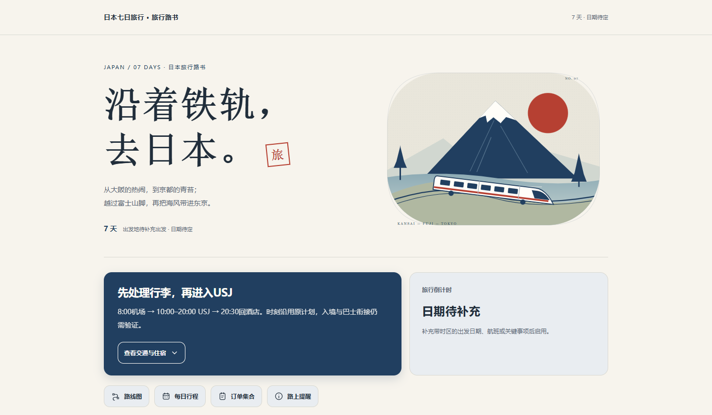
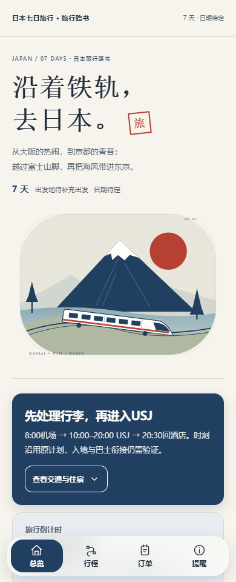
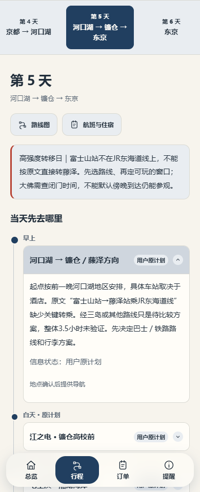
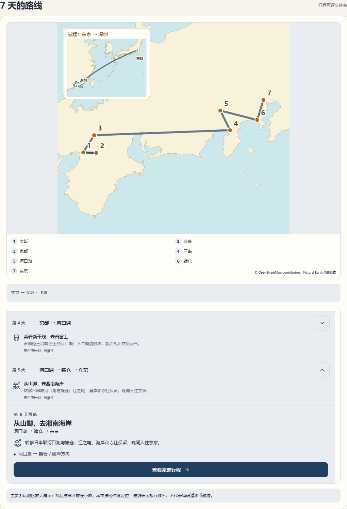

# Travel Roadbook · 旅行路书 Skill

**把一份旅行计划，变成能随身查看、继续补充的交互式路书。**

支持从粗略计划开始，整理逐日行程、路线概览、交通住宿、推荐与待办，并根据目的地制作视觉主题。交付可本地打开的 HTML，以及供后续更新的结构化数据和版本快照。

**源码公开 · 限非商业使用。** 允许符合许可的下载、使用、修改和再分发；商业用途需取得作者另行授权。完整条款见 [LICENSE](LICENSE)。

[下载技能包 / 完整源码包](https://github.com/howardxie54/travel-roadbook/releases/latest) · [Skill 入口](SKILL.md) · [当前发布检查](docs/validation.md)



## 看看效果

展示案例：**大阪 → 奈良 → 京都 → 富士山脚 → 镰仓 → 东京**。米白纸感、铁道蓝与朱印红，配合原创富士山和列车矢量插画。以下图片均来自包内实际网页，不是概念效果图。

<p align="center">
  
  
</p>



**直接体验：** 下载仓库后，用浏览器打开 [examples/japan/index.html](examples/japan/index.html)。GitHub 文件页面显示源码；需下载到本地后打开。此案例不是已确认出行安排，日期、班次、住宿与门票保留待确认状态。演示地图表示城市位置和旅行顺序。

## 能做什么

| 能力 | 具体行为 |
| --- | --- |
| 粗略计划起步 | 没有日期、航班或酒店也能出草稿，未知信息明确显示 |
| 目的地视觉 | 保留功能结构，按行程内容设计标题、配色与插画 |
| 每日行程 | 日期切换、当天主题、小总结、详情展开、逐日预览与滑动 |
| 路线概览 | 地理轮廓、城市位置、路线分段与交通方式播放 |
| 地图入口 | 按地点选择 Google Maps / 高德，提供备用入口与名称复制 |
| 订单与待办 | 整理交通、住宿、门票和其他订单；区分状态，保留冲突 |
| 持续修改 | 助手读取 `trip.json` 和 `history/`，保留不受影响的内容 |
| 本地查看 | 页面内嵌样式、脚本与本地素材；外部导航需要联网 |

网页供查看；继续改行程时交给助手处理。它没有网页内置编辑器或自动订票功能。

## 安装

### Codex

1. 下载本仓库，或下载 Release 中的 `travel-roadbook-skill.zip`。
2. 将 Skill 目录命名为 `travel-roadbook`，放到 `~/.codex/skills/`。Windows 对应 `%USERPROFILE%\.codex\skills\travel-roadbook\`。
3. 确认 `SKILL.md`、`scripts/`、`references/`、`assets/` 在同一层。开启新对话；未出现时重启 Codex。

仓库根目录本身就是 Skill。不要再套一层解压目录。

### 其他支持文件技能的助手

将目录放到宿主支持的技能位置，或让助手读取本目录的 `SKILL.md`。不同宿主的发现方式和工具能力有所区别，目前没有完成所有宿主的兼容性验证。

## 怎么用

先发粗略计划即可，不需要自己填写 JSON：

```text
$travel-roadbook
帮我做一份日本七日路书：大阪、奈良、京都、富士山、镰仓、东京。
日期和酒店还没定，希望有铁道旅行的感觉，手机上好看、好用。
先给我完整预览，建议和待确认信息请标清楚。
```

后续可以直接补充：

```text
第4天改到河口湖住一晚。京都酒店先保留，帮我检查住宿和交通有没有冲突。
```

```text
只恢复之前那版配色，保留最新行程和订单。
```

典型交付包括 `index.html`、`trip.json`、`history/`、项目素材和简短使用说明。重新开启对话时，提供整个项目目录以便续改。

## 运行要求

- **助手环境：** 能读取文件、编写文件并执行 Python。实际渲染验收需要浏览器工具。
- **生成器：** Python 3.7+，仅使用标准库；当前发布包在 Python 3.12 下验证。无需 Node.js、Remotion 或其他设计 Skill。
- **可选增强：** 宿主的联网检索、图片生成与地图核实工具。没有这些工具时使用内置布局/矢量素材，并保留待核实状态。
- **图片区别：** 示例包含定制日本主题和插画；安装 Skill 不意味着其他目的地自动生成完全相同的精修结果，助手仍需完成目的地设计。

## 本地生成日本示例

在仓库根目录执行：

```shell
python scripts/build_original.py examples/japan/trip.json examples/japan/index.html
```

然后打开 `examples/japan/index.html`。修改结构化内容或 `examples/japan/japan.css` 后重新生成即可。一般用户直接向助手描述修改，不必手动编辑数据。

## 验证与边界

发布包会检查文件完整性、解压后的实际生成、主题配色与浏览器主要交互。当前发布检查见 [docs/validation.md](docs/validation.md)。

- 已有组件验证覆盖 1–14 天和 320 / 390 / 1280px，另有日本七日成品实测；这不代表所有目的地、模型或宿主都经过测试。
- 地图是路线概览，默认不提供可拖动缩放的精细街道地图；Place ID 和真实手机 App 接管需要额外核实。
- 日期、班次、营业时间与预订资料仍须出发前复核；页面不会把缺失信息变成确认事实。
- 公开分享请从干净数据重新生成，检查 HTML、JSON、截图和导出文件；隐藏界面不能移除源文件中的私人信息。

## 仓库结构

```text
SKILL.md                 助手入口
scripts/                 生成器、主题与组件辅助脚本
references/              数据更新、设计、导航和验收规则
assets/                  脱敏模板、样式、交互和基础轮廓
examples/japan/          可重新生成的日本演示与素材
examples/*.json          修改与订单字段测试案例
docs/images/             README 真实展示截图
docs/validation.md       当前发布检查及限制
tools/package.py         制作轻量技能包与完整源码包
LICENSE                  PolyForm Noncommercial 1.0.0
NOTICE                   作者署名
THIRD_PARTY_NOTICES.md    地理数据和素材来源
```

## 打包与上传 GitHub

```shell
python tools/package.py
```

输出到 `dist/`：轻量 Skill ZIP、完整源码 ZIP 和 SHA-256 校验文件。Skill ZIP 保留基础示例和全部运行文件；完整源码 ZIP 另外包含日本演示、展示图与发布说明。

GitHub 仓库应上传**解压后的源码文件**，让首页直接显示 README 和展示图。ZIP 适合放在 **Releases** 中供下载。也可将日本演示部署为 GitHub Pages，但发布网页是单独的可选步骤。

## 许可

项目自有内容使用 [PolyForm Noncommercial 1.0.0](LICENSE)：允许符合条款的非商业使用、修改和再分发，并要求保留许可和署名。付费产品、收费代做、商业服务等商业用途需要作者另行授权；不能仅因下载免费就认定为非商业。

本项目属于带非商业限制的源码公开项目，不宣称符合 OSI 开源定义。第三方地理数据适用原许可，见 [THIRD_PARTY_NOTICES.md](THIRD_PARTY_NOTICES.md)。
